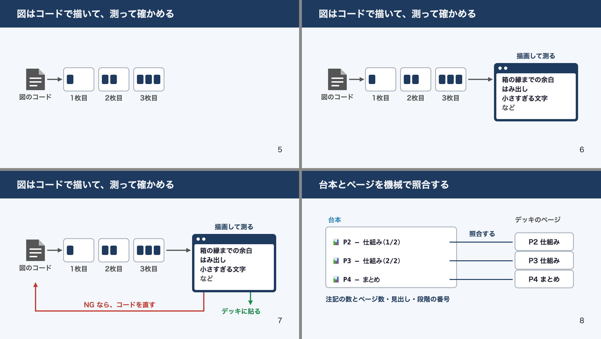

# script-to-slides

台本（Markdown）から、**図解主体・段階表示**の [Marp](https://marp.app/) スライドを作る Claude Code のプラグインです。
発表・講義・説明動画など、「話す内容が先にあって、それを話しながら映す資料」を作る人向けです。



上は、このプラグインの仕組みを、このプラグインで説明した見本です（[全ページ](examples/how-it-works/preview/)）。

## 何ができるか

- **台本が先、スライドはあと**: スライドの文字・数値・まとめは台本から導きます。まとめのページは台本と一字一句照合します
- **図解主体**: 内容のページは「見出し＋図1つ」。同じ図を数ページに割って、話に合わせて要素を足していきます
- **図はコードで描く**: Python で SVG を等倍で書き出します。人物・矢印・データベースなどの部品のライブラリ付き
- **測ってから見る**: 書き出した図をブラウザで描画して、余白・はみ出し・文字の小ささを実測します
- **台本とページの対応を機械で照合**: 台本の `📊 P3 — 見出し（2/3）` の注記とページを照合し、対応表を出します
- **レビュアーのエージェント付き**: 書き手と別のエージェントが、台本との整合・図の規則・見た目を確かめます

## 入れ方

```text
/plugin marketplace add kanpyou-maki/script-to-slides
/plugin install script-to-slides@script-to-slides
```

道具の準備（Python・Node.js・Chrome・Noto Sans JP）は [references/setup.md](skills/script-to-slides/references/setup.md) を見てください。

## 使い方

台本を用意して、Claude Code に「この台本からスライドを作って」と頼みます。手順は [SKILL.md](skills/script-to-slides/SKILL.md) にあります。

見本（どちらも、台本 `talk.script.md`・デッキ `talk.md`・図 `talk_figs.py` の3つ）:

| 見本 | 中身 |
|------|------|
| [examples/hand-drip/](examples/hand-drip/) | 最小の見本（7ページ）。新しく作るときのひな形 |
| [examples/how-it-works/](examples/how-it-works/) | このプラグインの仕組み（12ページ）。分岐・戻りの矢印・照合の線・薄くして強調する段階表示など、込み入った図の例 |

## 構成

```
skills/script-to-slides/
├── SKILL.md          手順
├── references/       規則（台本との整合性・図の規則・準備）
├── scripts/          build_slides.py・check_deck.py・check_figs.mjs・sheet_pages.py
└── assets/           theme.css・components.css・figlib.py
examples/             見本（hand-drip・how-it-works）
```

## 謝辞

図の規則と、図の文字の収まりを実測する方法は [minorun365/minorun-marp-skill](https://github.com/minorun365/minorun-marp-skill) を参考にしました。`scripts/check_figs.mjs` はその `check-svg-box-fit.mjs`（Apache License 2.0）をもとにしています。詳しくは [THIRD_PARTY_NOTICES.md](THIRD_PARTY_NOTICES.md)。

## ライセンス

MIT（[LICENSE](LICENSE)）。ただし `scripts/check_figs.mjs` は Apache License 2.0 のコードを含みます（[THIRD_PARTY_NOTICES.md](THIRD_PARTY_NOTICES.md)）。
