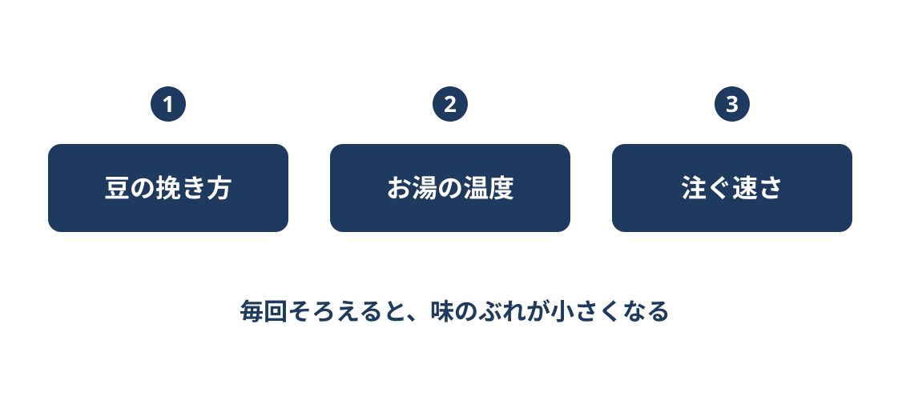

<!-- _class: title -->
<!-- _paginate: false -->

# ハンドドリップの3つのコツ

---

<!-- _class: content -->

## 味を決める3つのこと

---

<!-- _class: content -->

## 味を決める3つのこと

---

<!-- _class: content -->

## 味を決める3つのこと

---

<!-- _class: content -->

## 最初に少しだけ注いで待つ

---

<!-- _class: content -->

## 最初に少しだけ注いで待つ

---

<!-- _class: summary -->

## まとめ

1. 味を決めるのは、主に豆の挽き方・ お湯の温度・注ぐ速さの3つであること
2. 最初に少しだけ注いで30秒ほど待つ 「蒸らし」で、お湯が通りやすくなること
