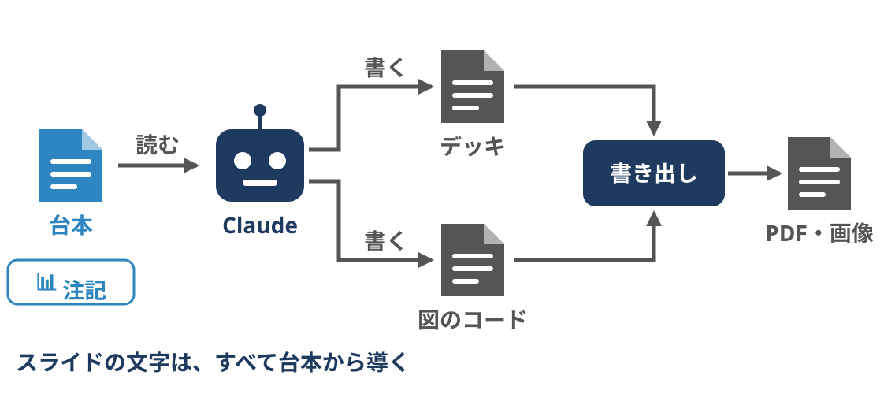
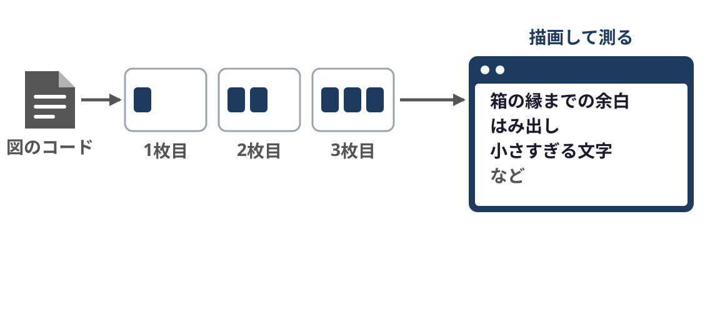
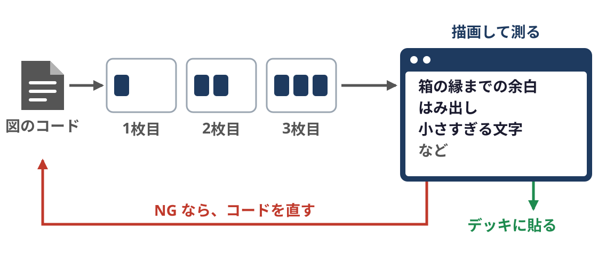
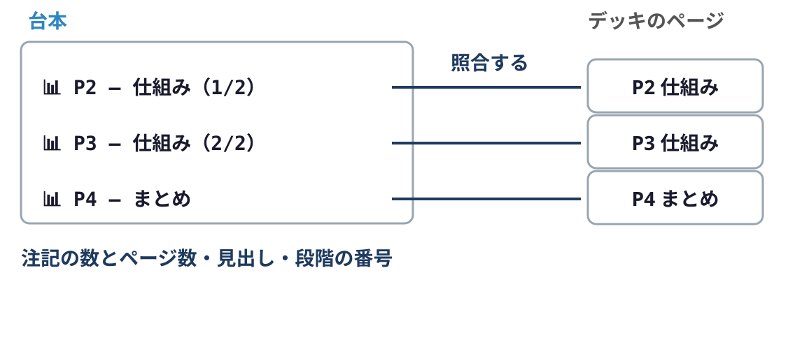
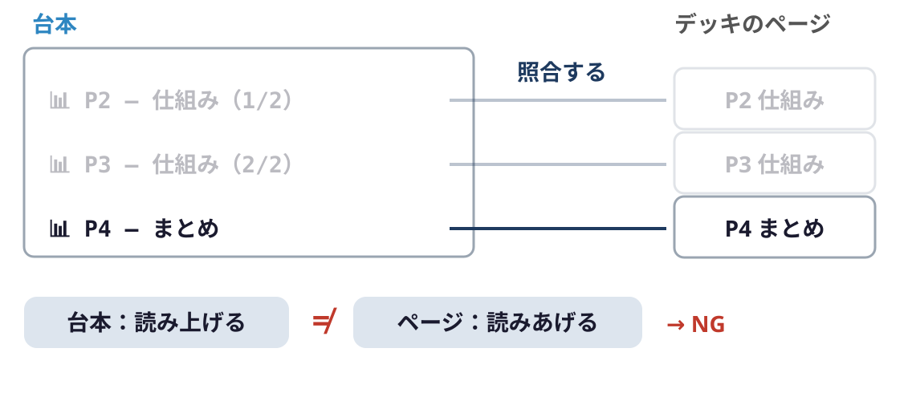
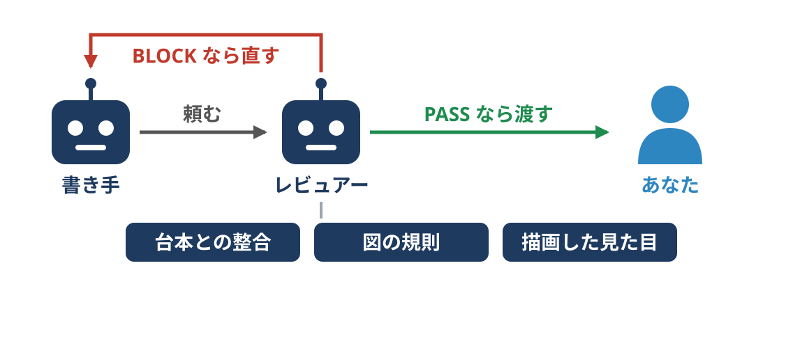

<!-- _class: title -->
<!-- _paginate: false -->

# 台本からスライドができるまで

---

<!-- _class: content -->

## 台本が先、スライドはあと

---

<!-- _class: content -->

## 台本が先、スライドはあと

---

<!-- _class: content -->

## 台本が先、スライドはあと

---

<!-- _class: content -->

## 図はコードで描いて、測って確かめる

---

<!-- _class: content -->

## 図はコードで描いて、測って確かめる

---

<!-- _class: content -->

## 図はコードで描いて、測って確かめる

---

<!-- _class: content -->

## 台本とページを機械で照合する

---

<!-- _class: content -->

## 台本とページを機械で照合する

---

<!-- _class: content -->

## 別のエージェントがレビューする

---

<!-- _class: content -->

## 別のエージェントがレビューする

---

<!-- _class: summary -->

## まとめ

1. 台本が先にあり、スライドの文字は 台本から導くこと
2. 図はコードで描き、ブラウザで描画して 実測してから使うこと
3. 台本とページの対応とまとめを道具が照合し、 別のエージェントがレビューすること
